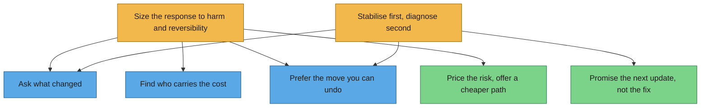

# ReasoningMapper

Turn an expert's own record of their work into **Claude skills that reason the way they do**.

ReasoningMapper reads someone's email archive, the documents they wrote, and transcripts of them thinking aloud through real problems in their field. It extracts the reasoning moves they actually make and groups those into habits, which the expert reviews and names. It then writes the result as Claude skills in a three-tier structure, with an orchestration map in the YAML. An agent can follow those skills when it meets a new situation in that field.

It runs locally by default. Your archive never leaves your machine unless you explicitly allow it, and even then only after redaction that has been independently verified.

```
corpus ─► ingest ─► authored text ─► threads ─► episodes ─► redact + verify
                                                                   │
skills ◄─ write-skills ◄─ align ◄─ link ◄─ draft ◄─ expert review ◄─ group ◄─ extract (open question)
```

## The three tiers

| Tier | What it holds | Relationship fields |
|---|---|---|
| **3 · orchestration** | how the expert decides what a situation needs | `source_skills` (what it orchestrates), `works_with` (peer tier 3s) |
| **2 · behavioral** | how they apply analysis in kinds of situation, or with people | `orchestrated_by` |
| **1 · structural** | the core analytical moves | `orchestrated_by` |

The orchestration map of the [worked example](examples/incident-commander): two tier 3 habits decide what an incident needs, and call on the tier 1 and 2 habits beneath them. Amber is tier 3, green tier 2, blue tier 1. `rmap visualize` draws this for any map, and also writes an interactive 3D version.



Every generated set also includes a router skill (`<prefix>-reasoning`). It lists the tier 3 activation cues and the orchestration map, so an agent knows where to start. The tool ships with an **empty** three-tier structure: your patterns come from your material, not from a taxonomy someone else wrote. See [docs/SKILL_FORMAT.md](docs/SKILL_FORMAT.md).

## Quick start

```bash
pip install -e '.[docs]'          # add [pst] for Outlook, [audio] for recordings, [anthropic] for the Claude API
rmap -C my-expert init            # writes rmap.yaml, calibration/known.yaml, .gitignore
# edit my-expert/rmap.yaml: your addresses, your field, your sources, your local models

rmap -C my-expert ingest          # PST, mbox/Gmail Takeout, .eml, docx/pptx/pdf/md, transcripts
rmap -C my-expert prepare         # strip quoted replies, attribute authorship, thread, classify episodes
rmap -C my-expert calibrate       # known-answer checks: do the instruments work on YOUR material?
rmap -C my-expert redact          # input-side redaction, audited by a second model family
rmap -C my-expert extract         # open extraction: what moves did the expert make?
rmap -C my-expert group           # moves -> candidate habits, written to review/moves.yaml
#   ...the expert reviews review/moves.yaml: keep / merge / drop, name each habit, give it a tier
rmap -C my-expert draft           # reviewed habits -> map/patterns.yaml
rmap -C my-expert link            # propose orchestration links from co-occurrence
                                  #   (--judge: the model proposes a parent for any left orphaned)
rmap -C my-expert visualize       # map/graph.html: the orchestration as an interactive 3D graph
#   ...edit map/patterns.yaml until `rmap validate` is clean
rmap -C my-expert align           # which general reasoning approaches does each habit build on?
rmap -C my-expert write-skills    # -> my-expert/skills/
```

`rmap status` shows where a project stands at any point.

## A worked example

[`examples/incident-commander`](examples/incident-commander) is a complete run on a fully synthetic expert: a fictional incident commander, with 23 emails, a guide they wrote and a think-aloud transcript. Every stage's output is committed, from the review decisions and the pattern map to the eight generated skills. It runs offline from recorded model responses, and the test suite rebuilds it byte for byte.

```bash
cd examples/incident-commander && python reproduce.py
```

A second example, [`examples/universal-reasoning-primer`](examples/universal-reasoning-primer), shows the same format holding nine hand-written, domain-general reasoning skills from Tucuxi's Universal Reasoning Primer.

## The reasoning catalog

[`catalog/`](catalog) holds a reference library of about 155 general reasoning approaches from logic, mathematics, probability, causal inference, decision theory, argumentation, social cognition and metacognition research. `rmap align` maps each of the expert's reviewed habits onto the catalog. Almost every habit applies something general. **The valuable part is usually what the habit adds**: the domain cues that tell the expert when to reach for the general move. Alignment records that as `beyond_general`. The catalog is never shown to the extractor (see [docs/METHOD.md §3 and §10](docs/METHOD.md)).

## Reasoning, and where it starts

[docs/REASONING.md](docs/REASONING.md) has the full discussion. It covers two things.

**The kinds of reasoning the literature has named.**
- Logic and mathematics: deduction, case analysis, proof by contradiction, Pólya's heuristics.
- Induction and abduction, from cases to rules and from surprises to explanations.
- Probabilistic, causal and counterfactual reasoning.
- Analogical and case-based reasoning.
- Problem solving and search; decision-making under uncertainty.
- Systems thinking; argumentation.
- Social and strategic reasoning; communication and framing.
- Metacognitive monitoring and control.

The catalog draws on all of these.

**Tucuxi's working theory of what lies underneath them.** Its central claim is that reasoning starts with **whether**: doubt that holds *P* and *not-P* open before any conditional reasoning begins. *If → then* is a branch that comes after commitment; *whether* is the trunk. It is also a **continuous governor** rather than a one-time switch. It decides:
- whether to reason at all;
- which dimensions need doubt;
- whether the depth is sufficient;
- when to commit;
- when to reopen a closed question.

The theory makes three further claims:
- **Six branches.** Applied to six domains, doubt becomes six kinds of reasoning, which natural language marks with six interrogatives:

  | Interrogative | Doubt applied to | Becomes |
  |---|---|---|
  | when | time | consequence modelling |
  | who | other minds | perspective revision |
  | why | one's own reactions | affect regulation |
  | what | attention | attentional reallocation |
  | how | one's own process | metacognitive monitoring |
  | where | context | constraint evaluation |

- **Three levels.** Doubt can also apply to itself: doubt within a dimension, about which dimensions to activate, and about one's own triggers.
- **What expertise is.** On this view, expertise is largely *compiled doubt*: knowing when to doubt which things, and how much. A mentor's real lesson is that calibration.

The document marks what is established and what is hypothesis. For example, cross-linguistic typology strongly supports *why* being the derived interrogative, but not all six being equally primary. It also explains why the theory predicts that an expert's tier 3 habits, the ones ReasoningMapper is built to capture, are that compiled *whether*.

## Why not just ask an LLM to summarise the emails?

Each design choice here answers a failure seen when this method was first built on a real 20-year archive. [docs/METHOD.md](docs/METHOD.md) has the full reasoning.

- **Authored text only.** Quoted reply chains are most of a typical body. Anything measured on raw length measures reply convention instead. One measured trend reversed sign once quotes were stripped.
- **No labels in the extraction prompt.** Every candidate label put in a prompt came back as output. The prompt asks an open question, and the expert names the habits afterwards.
- **A model judge decides what counts as the same habit.** Embedding similarity measures topic, not stance. On every local embedder tested, "diagnose first, stabilise second" sat closer to "stabilise first, diagnose second" than real paraphrases did.
- **Every instrument passes known-answer cases first.** `rmap calibrate` checks quote stripping, redaction, embedding and grouping against cases you write from your own material. A plausible wrong number has no symptom of its own.
- **Short, curt replies are kept.** Experts compress their reasoning once trust exists. A two-word decision is the contrast set for the long explanations, not noise.
- **Think-aloud sessions are first-class.** Email preserves the decision and decks preserve the answer; only a narrated session preserves the route. See [docs/THINK_ALOUD.md](docs/THINK_ALOUD.md).

## Privacy

By default everything stays local: local models, a local SQLite database, and no network calls except to your own Ollama server.

- **Redaction happens on the input**, so the extractor never sees the names. A model from a different family audits the result, and an episode counts as verified only when that audit comes back clean.
- **The Claude API backend refuses to send anything** until `allow_cloud: true` is set and the redaction calibration has passed. Even then it sends only verified episodes.

See [docs/PRIVACY.md](docs/PRIVACY.md).

## Requirements

- Python 3.10+.
- For real runs, [Ollama](https://ollama.com) with:
  - an instruct model for extraction (20–30B is a good size; a 12B model handled the grouping judge in testing);
  - a second model from a different family, for the redaction audit;
  - an embedding model (`nomic-embed-text` by default).
- The Claude API is optional.

## Claude Code plugin

[`plugin/`](plugin) packages two skills for Claude Code. One walks you through a ReasoningMapper project stage by stage. The other runs a think-aloud session as facilitator.

## License

Apache License 2.0. Copyright (C) 2026 Tucuxi, Inc. See [LICENSE](LICENSE) and [NOTICE](NOTICE).
