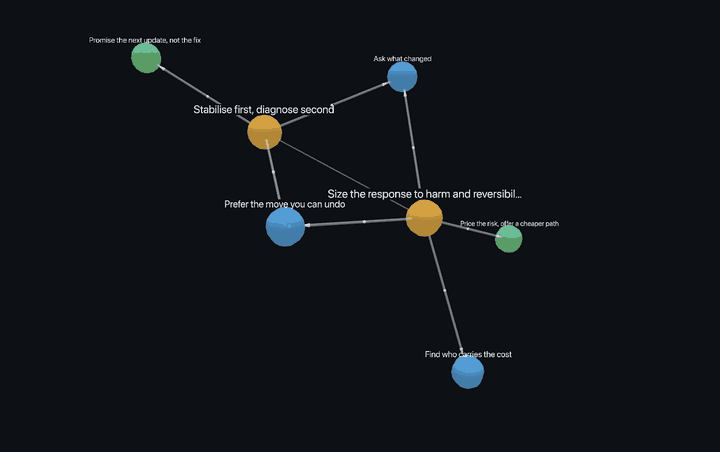

# Worked example: a fictional incident commander

Everything here is synthetic. Morgan Vale, Kestrel Row and Ferrolume are invented, and every address uses the reserved `.example` domain. The example runs offline: `models.backend: replay` answers each model call from `replay/`, and `embed_backend: hashing` embeds without a model.

The replayed answers come from two places. The extraction and drafting answers were written by hand to stand in for a model. The grouping and alignment answers were recorded from a real local judge (`gemma4:12b`, with `nomic-embed-text` shortlists).

```bash
python reproduce.py      # rebuilds rmap.db, review/, map/ and skills/ from corpus/ and replay/
```

`tests/test_example.py` runs the same rebuild and checks that the committed skills and map come out byte for byte.

## The material

| Source | What it is | Episodes |
|---|---|---|
| `corpus/mail.mbox` | 23 messages in 7 threads | 4 `adjustment`, 2 `curt_decision` |
| `corpus/docs/how-i-run-incidents.md` | a guide the expert wrote | 1 `document` |
| `corpus/think_aloud/session-01.md` | two problems worked aloud | 2 `think_aloud` |

The threads were written to show the shapes `prepare` looks for:
- **Adjustment exchanges.** For example, an engineer wants to root-cause a live outage before rolling back, and the expert explains why to stabilise first.
- **Curt decisions.** "No incident. Ticket it, fix Monday."
- **A logistics-only thread**, which is also curt by shape. Extraction is meant to return `no_reasoning` for threads like this.

## Walkthrough

**prepare.** Quoted replies are stripped, so each turn is what its sender wrote. Episode types follow from shape, measured on authored characters.

**calibrate.** `calibration/known.yaml` holds the known-answer cases.
- Authored text, redaction and grouping pass.
- **Embedding fails, on purpose.** The offline `hashing` embedder measures spelling, and the near-miss pairs catch it. ("find who carries the cost" vs "find what the change costs" scores 0.46, against 0.12 for a true paraphrase.)
- The real embedders tested on these cases also fail at least one near miss. That is why `rmap group` uses a model judge, not embedding clusters.

**redact.** All seven episodes that extraction reads end up verified clean. The two curt decisions are not redacted, because extraction does not read them. The vocabulary layer redacts every correspondent's name. The independent verifier then catches a codename the annotator missed: the transcript calls the main shipping database "Osprey" (see `replay/verify/session_1_0_0_0.json`). The codename is redacted and the episode audited again before it counts as clean.

**extract.** The prompt asks an open question and names no patterns. 29 moves come back, nearly all with distinct names.

**group.** The judge turns the 29 moves into 14 candidate habits. It puts the reversibility fragments together, but it keeps "stabilise first, diagnose second" apart from "capture evidence before the rollback". It also keeps "estimate time available before acting" separate, where hashing clusters had wrongly filed it with update-time habits because of the shared word "time".

**review.** The expert's decisions are in `review/moves.yaml` (and as data in `reproduce.py`):
- 7 habits kept and named in the expert's own words;
- 6 merged into those, for example capturing evidence and rehearsing the rollback into "Prefer the move you can undo";
- 1 dropped as too thin to teach from.

**draft and link.** Co-occurrence proposes orchestration, and leaves three habits with no tier 3 parent. The expert decides that weighing a risky request *is* sizing the response by harm and reversibility, and places them there. `rmap validate` then comes back clean. `rmap visualize` draws the finished orchestration as [`map/graph.html`](map/graph.html); open it in a browser.



*`rmap visualize` on this map, recorded from `map/graph.html`. In the browser you can rotate it, click a habit to read it, and filter by tier or link type.*

**align.** Each habit is mapped onto the general reasoning catalog. "Ask what changed" applies the method of difference. "Prefer the move you can undo" applies reversibility assessment and staged commitment. Each skill also records what the habit adds beyond the general approach.

## The result

```
TIER 3  Size the response to harm and reversibility ──┬── Ask what changed                  (1)
        Stabilise first, diagnose second ─────────────┼── Prefer the move you can undo      (1)
                                                      ├── Find who carries the cost         (1)
                                                      ├── Promise the next update, not the fix (2)
                                                      └── Price the risk, offer a cheaper path (2)
```

Start at `skills/incident-commander-reasoning/SKILL.md`, the router, then open any tier 3 skill.
